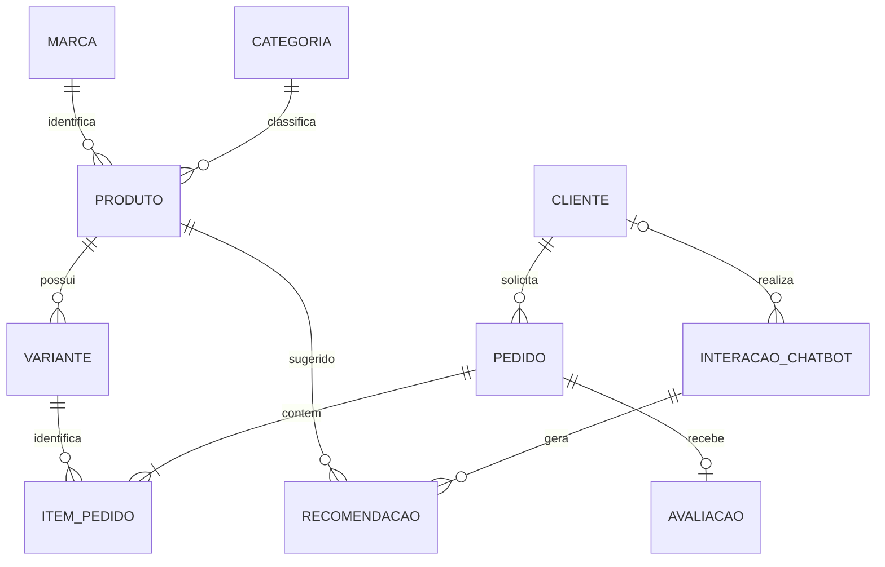

# Modelo conceitual — IMPÉRIUM BAHIA / ByteMind

Modelo da integração demonstrativa implementada. As seis entidades obrigatórias são Cliente, Produto, Pedido, Categoria, Interação_Chatbot e Recomendação. Incluímos Item_Pedido para resolver a relação N:N entre Pedido e Produto e Avaliação para registrar feedback. Marca e Variante complementam o catálogo. O chat aceita visitantes, mas a versão atual só registra interações de clientes autenticados que optarem pelo registro.

## Modelo lógico
- CLIENTE(id PK, nome, email UQ, senha_hash, criado_em)
- CATEGORIA(id PK, nome UQ)
- MARCA(id PK, nome UQ)
- PRODUTO(id PK, categoria_id FK, marca_id FK, nome, descricao, preco, imagem, ativo)
- VARIANTE(id PK, produto_id FK, sku UQ, tamanho, cor, estoque)
- PEDIDO(id PK, cliente_id FK, subtotal, desconto, frete, total, cupom, status, criado_em)
- ITEM_PEDIDO(pedido_id PK/FK, variante_id PK/FK, quantidade, preco_unitario)
- INTERACAO_CHATBOT(id PK, cliente_id FK opcional, sessao, pergunta, resposta, modo, criado_em)
- RECOMENDACAO(id PK, interacao_id FK, produto_id FK, posicao, pontuacao)
- AVALIACAO(id PK, pedido_id FK UQ, estrelas, observacoes, criado_em)

O DER representa regras do domínio. A obrigação de pelo menos um item por pedido e a consistência dos totais são verificadas na transação do backend. A execução no MySQL real permanece pendente de validação. A chave de pedido preserva o preço histórico em ITEM_PEDIDO. O arquivo SQL detalha as restrições.
